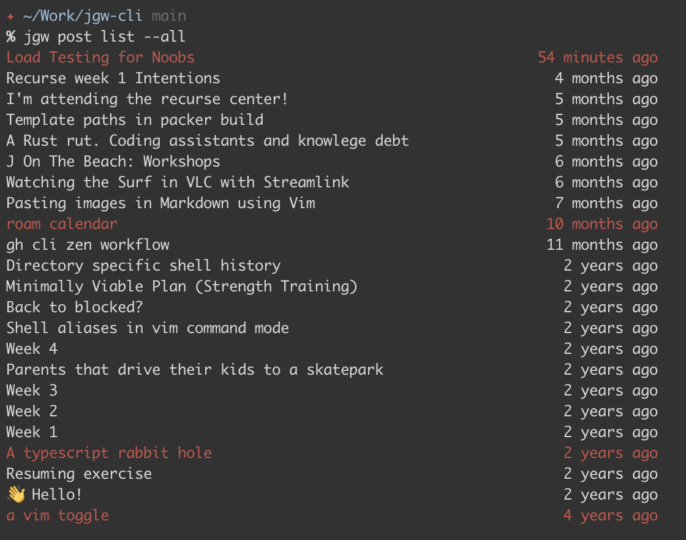

# JGW cli tool

A cli utility to interact with my blog/website. It allows you to create, list, and edit posts.



### Usage

- Create a post: `jgw post new --title "Post title"`
- List posts: `jgw post list` (use `--all`/`-a` to include drafts)
- Edit a post: `jgw post edit` (use `--all`/`-a` to include drafts)

Posts are read from and written to `${config.path}/build/posts/` where `config.path` comes from your config.

### Development

It's developed using [TypeScript](https://www.typescriptlang.org) and [Bun](https://bun.sh).

Install dependencies:
```
bun install
```

In order to be able to call the jgw command globally, you need to link it from
the global scope

```
bun run install-global
```

When developing, you can run TypeScript directly without compilation:

```
bun run dev
```

Or execute the TypeScript file directly:
```
./src/index.ts
```

### Testing

This project uses Vitest. Use one of the following commands:

```
bun run test
# or
bun x vitest run
```

Note: `bun test` (Bun’s built-in test runner) is not supported for this repo since the tests rely on Vitest APIs like `vi.mock` and `vitest.config.ts`.

